

  <a href="https://harshbaee.github.io/hotel-analysis-preview/"></a>

  
  
  

  
  
  
  
  

<b>An internship project by Harsh Prajapati and Charmi Shah</b> 
Master 2 Recherche, CY Tech · 2025/2026 · one full year, 1 October 2025 to 30 September 2026

> [!NOTE]
> **Preview only.** This repository shows the project; it does not share it. The hotel's name is withheld, its raw data
> and the project's code are not published, and nothing here may be reused (see [Rights](#rights)).

## The year at a glance


A 57-room hotel with a restaurant, read from a copy of its own management software. Over the year it brought in
**€1.13M** of sales without VAT and an estimated operating profit of **€369K** (32.6% of sales). Summer carries
everything: June to September earned **95%** of the profit, while four winter months ran at a loss.

## 1 · The dashboard, the main preview

  <a href="https://harshbaee.github.io/hotel-analysis-preview/">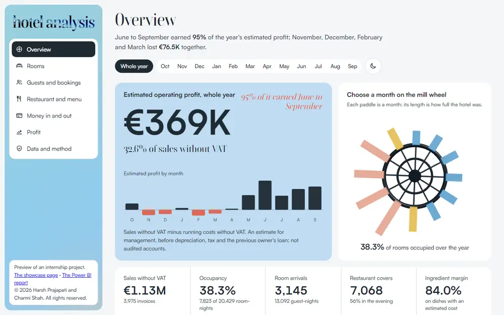</a>

A seven-view dashboard that runs in the browser, with no server and no tracking. **[Open it →](https://harshbaee.github.io/hotel-analysis-preview/)**

- **One month, every view.** Pick a month on the 3D mill wheel (twelve paddles, each as long as that month was full) or on the
  month bar, and the overview, rooms, guests, restaurant, money, profit and method views all follow.
- **Every night of the year.** A calendar of 365 nights with a liquid-glass lens to drag across it.
- **Built to be read.** Each view starts with its finding in one sentence, then the figures, then the charts; light and dark mode.

<table>
  <tr>
    <td width="33%">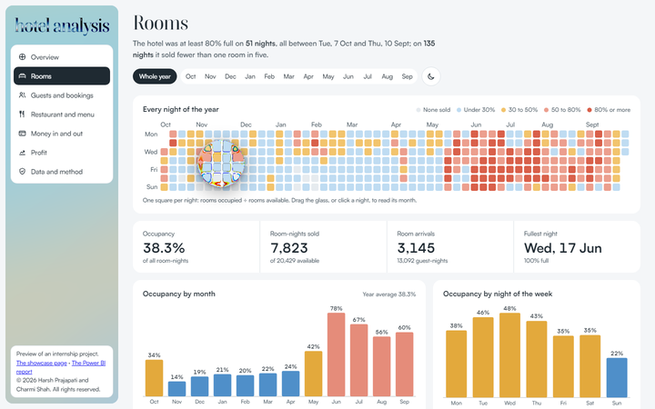</td>
    <td width="33%">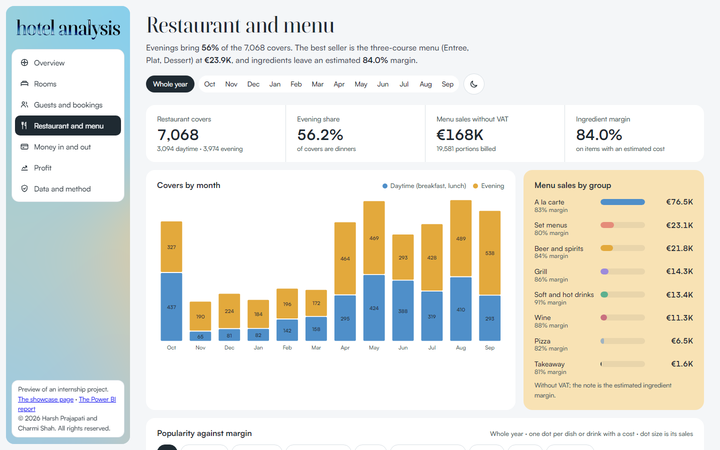</td>
    <td width="33%">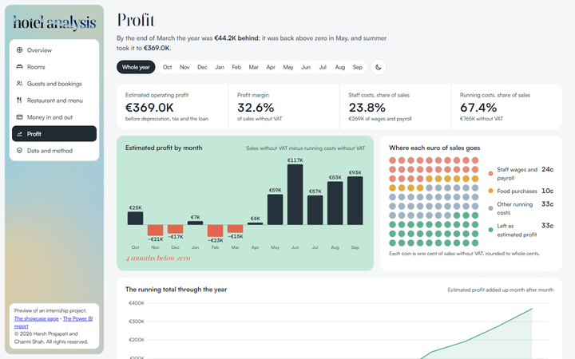</td>
  </tr>
  <tr>
    <td align="center">Rooms: 365 nights under glass</td>
    <td align="center">Restaurant and menu</td>
    <td align="center">Profit, month by month</td>
  </tr>
</table>

## 2 · The showcase page

  <a href="https://harshbaee.github.io/hotel-analysis-preview/showcase/">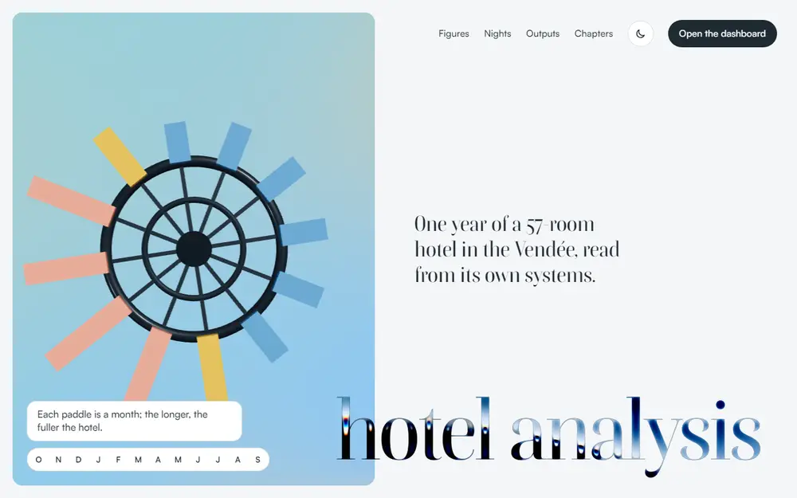</a>

A one-page tour of the project. **[Open it →](https://harshbaee.github.io/hotel-analysis-preview/showcase/)**

- A fixed stage with a moving shader gradient and the 3D mill wheel (React Three Fiber); hover or click a paddle to read a month.
- The name in liquid metal, the nights under a liquid-glass lens, and the project's outputs laid out as real pages.
- Five chapters (rooms, tables, money, profit, checks) whose titles tear apart at the seam as you scroll.

## 3 · The Power BI report

<table>
  <tr>
    <td width="50%"></td>
    <td width="50%"><a href="https://harshbaee.github.io/hotel-analysis-preview/powerbi.html">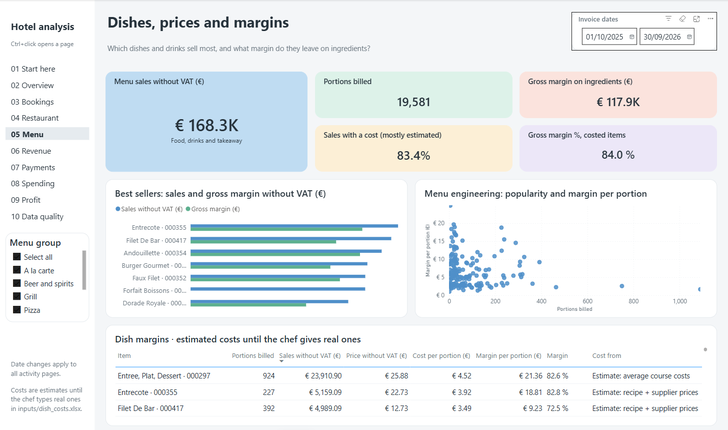</a></td>
  </tr>
  <tr>
    <td width="50%"><a href="https://harshbaee.github.io/hotel-analysis-preview/powerbi.html">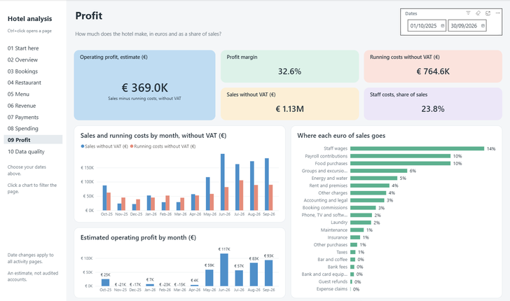</a></td>
    <td width="50%"><a href="https://harshbaee.github.io/hotel-analysis-preview/powerbi.html">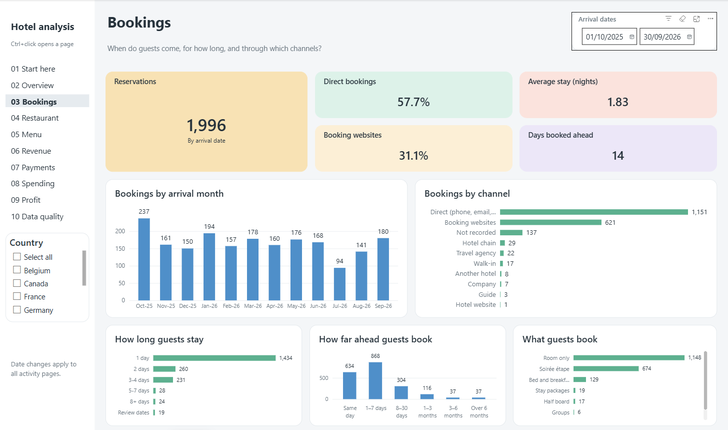</a></td>
  </tr>
</table>

The tool the hotel keeps: ten pages in Power BI Desktop, one question per page, with the dates kept in step across pages.
**[See eight of its pages →](https://harshbaee.github.io/hotel-analysis-preview/powerbi.html)**

## How it was built


<b>The data</b>: a copied hotel database, decoded table by table

 

The hotel runs on Vega, a hotel management system. A copy of its database (83 tables, 1,276,245 rows, no documentation) was
exported read-only and decoded table by table: the daily activity report, the four VAT groups on each invoice, five payment
slots per invoice, booking channels and segments, and the restaurant till. Spending came from the supervisor's file, and nine
photos of the till checked the price list.

<b>Cleaning and checks</b>: written rules, nothing deleted quietly

 

Four Python notebooks explore, clean and validate the data, then cost the menu. Missing, blank and zero stay apart, credits are
kept, and no record is dropped without a written rule. 1,722 automatic checks compare every figure in the report with the raw
data: 1,474 on the files and 248 live on the open report.

<b>The model</b>: 35 tables, 29 relationships, 126 DAX measures

 

Each subject (bookings, invoices, payments, spending, menu sales, the daily report) keeps its own grain and date meaning and
meets the others only through a shared calendar, so unrelated figures never look comparable. Dish costs are estimated from basic
recipes priced at the cheapest supplier products, and every estimate is labelled as one.

<b>Privacy</b>: the hotel's data stayed on its own computer

 

All processing ran locally. Guest, staff and bank records were only counted, never shown. This preview holds summary figures
only, with the hotel's name withheld.

## What the year showed

1. **Summer carries the year.** June was 78% full; from November to April the hotel never reached a quarter full.
2. **Business guests fill the week.** Tuesday to Thursday are the busiest nights, and most reservations are individual business trips.
3. **Guests book direct, and late.** 58% of reservations come direct, and three in four are made a week or less ahead.
4. **The restaurant feeds the hotel.** 56% of its 7,068 covers are dinners, mostly for hotel guests.
5. **About a third of each euro is left.** The estimated operating profit is 32.6% of sales, before depreciation and tax.

## Team

<table>
  <tr>
    <td width="50%" valign="top">
      <b>Harsh Prajapati</b> 
      Data and back end  
      Extraction and decoding of the database, the cleaning and validation notebooks, the Power BI model and its DAX measures,
      the dish cost estimates and the automatic checks.
    </td>
    <td width="50%" valign="top">
      <b>Charmi Shah</b> 
      Front end and design  
      The Power BI report's design, the logo and visual identity, the presentation, the dashboard website and the showcase page.
    </td>
  </tr>
</table>

## Rights

© 2026 Harsh Prajapati and Charmi Shah. **All rights reserved.** This repository is shared for viewing only: no part of it
may be copied, modified, reused or distributed without the authors' written permission. See [LICENSE](LICENSE).
