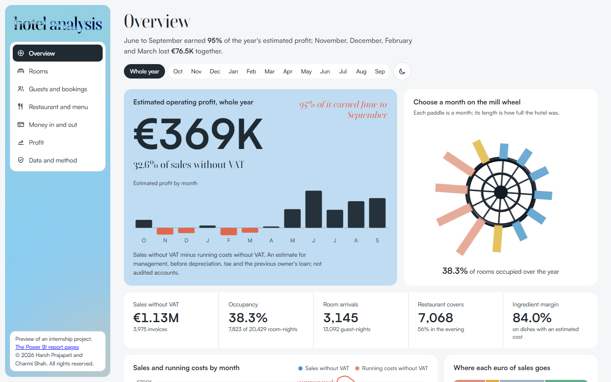
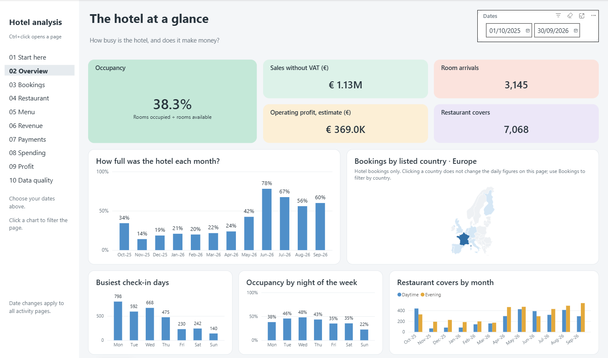

# Hotel analysis: one year of a 57-room hotel

**Live preview: [https://harshbaee.github.io/hotel-analysis-preview/](https://harshbaee.github.io/hotel-analysis-preview/)**

An internship project (Master 2 Recherche, CY Tech, 2025/2026) by **Harsh Prajapati** and **Charmi Shah**.
It turns a copy of a hotel's management software into checked figures for one year, 1 October 2025 to
30 September 2026: how full the hotel was, who stayed, what the restaurant sold and earned, where the money
came from and went, and what was left. The hotel's name is withheld.

This repository is a **preview only**. It holds the dashboard website and pictures of the Power BI report;
the project's code, notebooks and the hotel's data are not published.

## 1. The dashboard

The live preview above: a seven-view dashboard (overview, rooms, guests and bookings, restaurant and menu,
money, profit, data and method). Pick a month on the 3D mill wheel and every view follows it.

## 2. The Power BI report

A ten-page report built in Power BI Desktop: [see the pages](https://harshbaee.github.io/hotel-analysis-preview/powerbi.html).

## How it was built

- **Data:** a copy of the hotel's Vega database (83 tables, 1,276,245 rows), exported read-only and cleaned with
  four Python notebooks (pandas) under written rules.
- **Model:** a Power BI model with 35 tables, 29 relationships and 126 DAX measures.
- **Checks:** 1,722 automatic checks compare every figure with the raw data, and all of them pass.
- **Front end:** the Power BI report design, a 22-slide presentation, this dashboard (HTML, CSS, JavaScript,
  React Three Fiber) and a showcase page.

Harsh Prajapati built the data back end (extraction, cleaning, validation, the model and the checks).
Charmi Shah designed the front end (the report's design, the presentation, the dashboard and the showcase).

## Rights

© 2026 Harsh Prajapati and Charmi Shah. **All rights reserved.** Shared for viewing only: no part of this
repository may be copied, modified, reused or distributed without the authors' written permission.
See [LICENSE](LICENSE).
